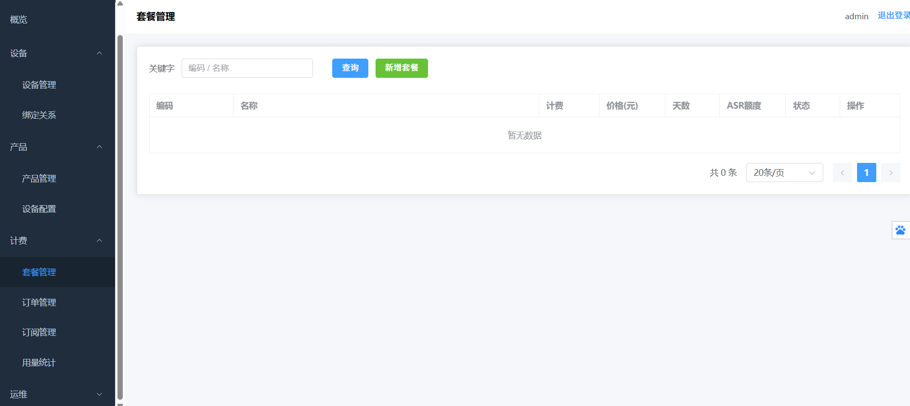
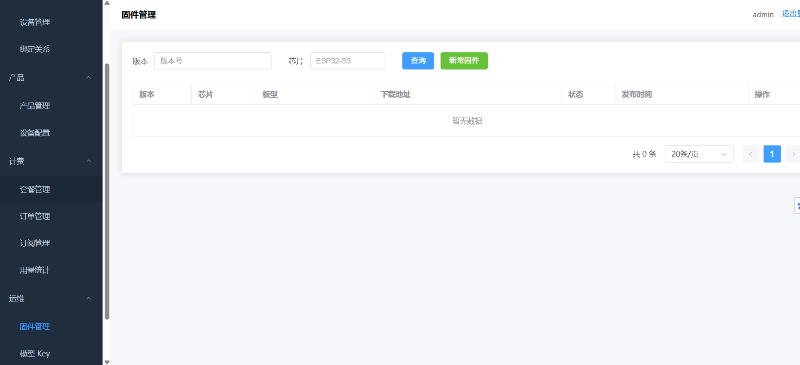

<div align="center">

# 道玄 AI 语音助手 · ESP32 固件

**Daoxuan AI Voice Assistant — Open-Source ESP32 Voice Firmware**

[](LICENSE)
[](docs/)
[](https://github.com/espressif/esp-idf)
[](main/)
[](vue-ai/)

**开箱即用的 AI 语音固件 · OTA 激活 · WebSocket 实时对话 · MCP 设备控制 · Vue 管理后台**

[English](README.md)

</div>

---

## 项目简介

**道玄 AI 语音助手**是运行在 ESP32 系列芯片上的开源 AI 语音固件，由上海道玄微数信息科技有限公司基于 MIT 协议的开源语音框架二次开发并持续维护。

刷入固件、连接 Wi-Fi，设备即可语音唤醒、实时对话、执行设备指令，并支持远程 OTA 升级与设备授权管理。

- **零配置接入**：固件内置官方服务地址，烧录即可使用
- **完整链路**：麦克风采集 → Opus 编码 → 流式识别 → 大模型 → 语音合成 → 播放
- **多芯片支持**：ESP32 / ESP32-C3 / ESP32-C5 / ESP32-C6 / ESP32-S3 / ESP32-P4
- **多板型支持**：100+ 开发板，覆盖乐鑫、M5Stack、微雪、立创、LILYGO 等主流硬件
- **可私有化**：服务端、语音服务、模型 Key 均可自持

> 适合：AI 硬件开发者、语音交互产品团队、智能玩具 / 陪伴机器人 / 桌面助手厂商。

---

## 核心能力

| 能力 | 说明 |
| --- | --- |
| 离线语音唤醒 | 基于 ESP-SR，本地唤醒，低延迟、低功耗 |
| 实时语音对话 | WebSocket 长连接，Opus 16k 音频流 |
| 大模型接入 | DeepSeek / 通义千问 / 豆包 / OpenAI 兼容接口 |
| 语音识别与合成 | 服务端 ASR + TTS，支持中英多语言 |
| MCP 设备控制 | 音量、屏幕、灯光、电机、摄像头等设备工具 |
| OTA 远程升级 | 版本管理、灰度发布、远程重启 |
| 设备授权 | 激活码绑定、账号归属、禁用控制 |
| 多语言界面 | 38 种界面语言，语音资源本地化 |
| 配网方式 | 热点配网、BluFi 蓝牙配网、有线以太网、4G |
| 管理后台 | 设备、产品、套餐、订单、固件、审计一站式管理 |

---

## 系统架构

```text
┌──────────────┐        ┌──────────────────┐        ┌─────────────────┐
│  ESP32 设备   │  OTA   │   Java 服务端     │  HTTP  │  Python 语音服务 │
│  麦克风/喇叭  │ ─────► │  激活 / 授权      │ ─────► │  ASR / TTS      │
│  Opus 编解码  │  WSS   │  WebSocket 网关   │        │  ffmpeg / 模型   │
└──────────────┘ ◄───── └──────────────────┘        └─────────────────┘
        │                        │                          │
        │                        ▼                          ▼
        │               ┌──────────────────┐        ┌─────────────────┐
        └──────────────►│   Vue 管理后台    │        │  大模型 API      │
                        │  设备/套餐/固件    │        │ DeepSeek/Qwen   │
                        └──────────────────┘        └─────────────────┘
```

---

## 支持的芯片

| 芯片 | 推荐场景 |
| --- | --- |
| ESP32-S3 | 首选，带屏、摄像头、AEC 全功能 |
| ESP32-C3 | 低成本挂件、语音玩具 |
| ESP32-C5 / C6 | 新平台，Wi-Fi 6 / 低功耗 |
| ESP32-P4 | 高性能屏显设备 |
| ESP32 | 基础语音 |

---

## 快速开始

### 1. 环境要求

- **ESP-IDF v6.1**（最低 v6.0.1，不支持 5.x）
- Git、Python 3.10+
- USB 数据线、ESP32 开发板

### 2. 获取源码

```bash
git clone https://github.com/wuzhiguoyy/esp-32.git
cd esp-32
```

### 3. 选择板型

```bash
idf.py menuconfig
# Xiaozhi Assistant → Board Type
```

### 4. 设置芯片并编译

```bash
idf.py set-target esp32s3
idf.py build
```

### 5. 烧录

```bash
idf.py -p COM3 flash monitor
```

### 6. 开机激活

设备联网后屏幕显示 **6 位激活码**，在管理后台或客户端输入该激活码完成绑定，设备自动激活。

### No toolchain? Use prebuilt firmware

End users do not need ESP-IDF. Download the `.bin` and flash with one script:

👉 **[Quick Start (5 steps)](docs/quickstart_zh.md)** · Flasher: [tools/flash.bat](tools/flash.bat)

完整教程：[README_zh.md](README_zh.md)

---

## 管理后台

`vue-ai/` 提供完整的设备运营后台：

**Live Demo**: <https://wuzhiguoyy.github.io/esp-32/#/login>

| Demo account | Password | Role |
| --- | --- | --- |
| `demo` | `demo123` | Viewer (read-only) |

> The demo account is for evaluation only. Please do not modify data; register your own account for production use.

### Screenshots

<table>
<tr>
<td align="center"><br>Login</td>
<td align="center"><br>Dashboard</td>
<td align="center"><br>Devices</td>
</tr>
<tr>
<td align="center"><br>Plans</td>
<td align="center"><br>Firmware</td>
<td align="center"><br>Model keys</td>
</tr>
</table>

```bash
cd vue-ai
npm install
npm run dev
```

| 模块 | 功能 |
| --- | --- |
| 设备管理 | 绑定 / 解绑 / 禁用 / 在线状态 |
| 产品配置 | 板型、运行模式、音色、唤醒词 |
| 计费管理 | 套餐、订单、订阅、用量统计 |
| 固件管理 | 版本、下载地址、灰度发布 |
| 模型 Key | 平台 / 客户 / 设备三级 Key |
| 操作审计 | 后台操作全量留痕 |

支持 GitHub Pages 自动部署，配置 `VITE_API_BASE` 后推送即可发布。

---

## 适用场景

- AI 语音助手 / 智能音箱
- 儿童陪伴机器人 / 故事机
- 桌面机器人 / 摆件
- 智能家居中控
- 多语种翻译挂件
- 企业定制语音终端

---

## FAQ

**Can ESP32 run an AI voice assistant?**
Yes. This firmware handles audio capture, Opus encoding, playback and device control; ASR, LLM and TTS run on the server.

**Which chips are supported?**
ESP32, ESP32-C3, ESP32-C5, ESP32-C6, ESP32-S3 and ESP32-P4.

**Does it need internet?**
Wake word detection is on-device; speech recognition, LLM and TTS require network access.

**Which LLM providers work?**
DeepSeek, Qwen, Doubao and any OpenAI-compatible endpoint. Keys can be configured per platform, per customer or per device.

**Can I self-host the server?**
Yes. Implement the OTA and WebSocket protocols documented in `docs/`.

**What hardware cost should I expect?**
An ESP32-S3 board plus microphone and speaker starts at a few dollars, suitable for prototyping and small batch production.

---

## Documentation

| 文档 | 说明 |
| --- | --- |
| [README_zh.md](README_zh.md) | 完整使用、烧录、激活、常见问题 |
| [docs/custom-board_zh.md](docs/custom-board_zh.md) | 自定义开发板 |
| [docs/ota_zh.md](docs/ota_zh.md) | OTA 与激活协议 |
| [docs/websocket_zh.md](docs/websocket_zh.md) | WebSocket 语音协议 |
| [docs/mcp-usage_zh.md](docs/mcp-usage_zh.md) | MCP 设备控制 |

---

## 仓库镜像

- GitHub：`https://github.com/wuzhiguoyy/esp-32`
- Gitee（国内加速）：`https://gitee.com/wuzhiguo/esp-32`

---

## 贡献

欢迎提交 Issue 与 Pull Request。

- 代码风格：Google C++ Style
- 提交前请在本机 `idf.py build` 通过
- 新增板型请附 `config.h`、`config.json` 与接线说明

---

## 许可证

本项目基于 **MIT 协议** 的开源 ESP32 语音框架二次开发，原始版权归原作者所有，`LICENSE` 文件必须保留。

品牌、文档与发行由 **上海道玄微数信息科技有限公司** 维护。

开源范围为设备端固件源码；官方服务器、语音识别、大模型与语音合成属于商业服务。

---

<div align="center">

**道玄 AI 语音助手** · 让每一块 ESP32 都能开口说话

</div>
