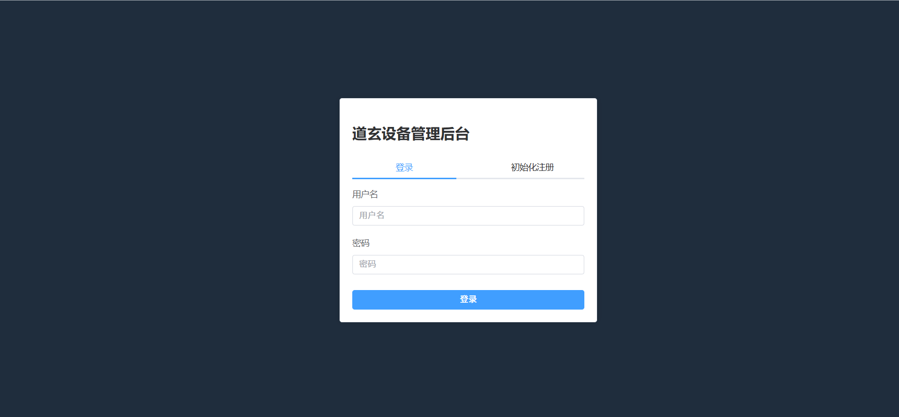
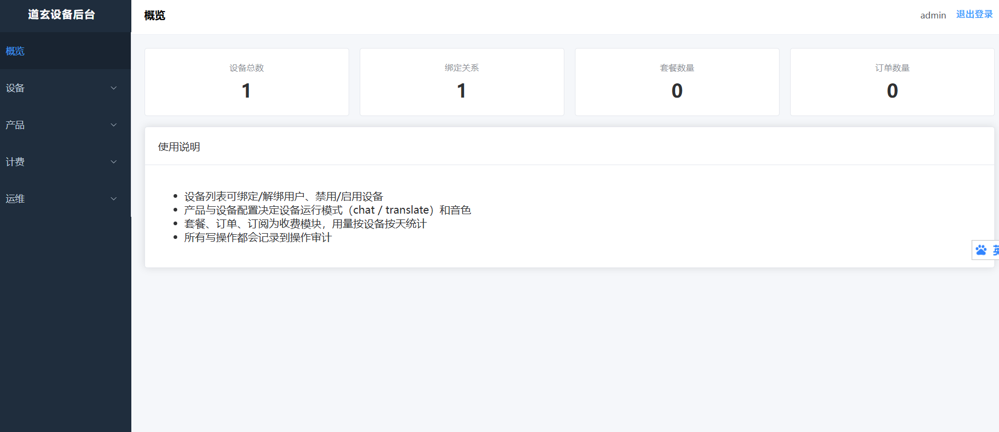
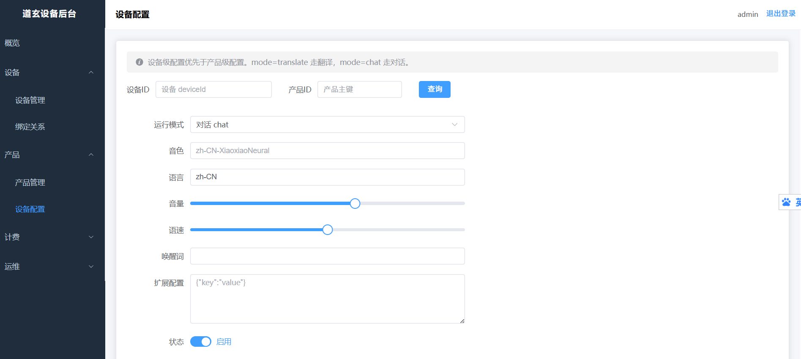
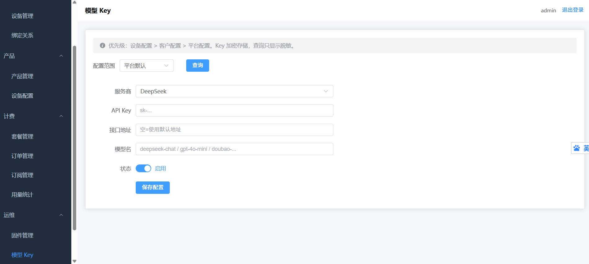

<div align="center">

# Daoxuan AI Voice Assistant · ESP32 Firmware

**Open-source AI voice firmware for ESP32 · OTA activation · real-time LLM voice chat · MCP device control · Vue admin console**

[](LICENSE)
[](docs/)
[](https://github.com/espressif/esp-idf)
[](main/)
[](vue-ai/)

[中文](README_zh.md) · [日本語](README_ja.md)

</div>

---

## Introduction

**Daoxuan AI Voice Assistant** is an open-source AI voice firmware running on the ESP32 family, developed and maintained by Shanghai Daoxuan Weishu Information Technology Co., Ltd. on top of an MIT-licensed voice framework.

Flash the firmware, connect Wi-Fi, and the device can wake on voice, hold real-time conversations, execute device commands, and support OTA activation and device licensing.

- **Zero configuration**: official service endpoint is built in, flash and use
- **Full pipeline**: microphone → Opus encode → streaming ASR → LLM → TTS → playback
- **Multi-chip**: ESP32 / ESP32-C3 / ESP32-C5 / ESP32-C6 / ESP32-S3 / ESP32-P4
- **Multi-board**: 168 board configurations from Espressif, M5Stack, Waveshare, LCKFB, LILYGO and more

**Keywords**: ESP32 AI voice assistant, open-source ESP32 firmware, ESP32-S3 voice chat, offline wake word, LLM voice interaction, MCP device control, OTA activation, AI hardware solution, smart toy, companion robot, translation pendant.

### What you may be searching for

- ESP32 voice assistant with DeepSeek / Qwen / Doubao
- ESP32-S3 voice development board firmware
- Open-source AI voice firmware for commercial products
- ESP-IDF voice assistant template
- Voice firmware with device activation and licensing
- Offline wake word + cloud ASR/TTS architecture
- Kids companion robot voice solution
- Chinese-English translation pendant firmware

### Tech stack

| Layer | Technology |
| --- | --- |
| Firmware | C / C++, ESP-IDF v6.1, FreeRTOS, ESP-SR |
| Audio | Opus 16k, I2S, AEC |
| Protocol | WebSocket, MQTT, HTTP, MCP (JSON-RPC) |
| Backend | Java 17, Spring Boot, MyBatis-Plus, MySQL, Redis |
| Voice service | Python, FastAPI, faster-whisper, edge-tts |
| Admin | Vue 3, Vite, Element Plus |
| Storage | Alibaba Cloud OSS |

---

## Core features

### Built in

| Area | Capability |
| --- | --- |
| Voice | Offline wake word, Opus 16k streaming chat, interruption, continuous dialog |
| Device | Volume, screen, LED, motor, camera control via MCP (150+ tools) |
| Power | Battery estimation, low-power sleep |
| Network | Wi-Fi hotspot, BluFi, Ethernet, 4G modules |
| Cloud | OTA config, activation code licensing, DeepSeek / Qwen / Doubao, ASR + TTS |
| Admin | Devices, online status, products, boards, voices, firmware versions |
| Billing | Plans, orders, subscriptions (hidden by default, can be enabled) |

### Optional features (compile flags, hardware required)

| Feature | Switch | Hardware | Status |
| --- | --- | --- | --- |
| GPS location reporting | `ESP32_FEATURE_GPS` | GPS module | Code complete |
| Door lock / access control | `ESP32_SHOP_LOCK` | Relay + lock | Code complete |
| HX711 weight sensor | `ESP32_SHOP_WEIGHT` | Load cell | Code complete |
| RC522 RFID reader | `ESP32_SHOP_RFID` | RC522 module | Code complete |
| Photo capture & upload | built-in | Camera (JPEG output) | Code complete |
| RTSP MJPEG streaming | `ESP32_RTSP_SERVER` | Camera | Code complete |
| Activation code over serial | built-in | None | Code complete |

### Server-side support

| Feature | Description |
| --- | --- |
| Unified file table | `esp32_file` stores recordings, photos and videos; business keeps only `fileId` |
| File upload | One endpoint for users, devices and internal services |
| Video recording | Python pulls RTSP → segments MP4 → uploads → registers metadata |
| Device location | Coordinate reporting API + `esp32_location` table |
| Role isolation | Customers see only their devices; admin APIs require admin role |

### Not implemented yet

| Feature | Reason |
| --- | --- |
| Continuous on-device recording | Server pipeline ready; firmware does not keep the mic open |
| Real-time video calls | ESP32 cannot sustain video; only low-FPS MJPEG streaming |
| USB barcode scanner / thermal printer | Not integrated |
| OTA firmware upgrade delivery | Firmware side ready; server upgrade URL not configured |

---

## Architecture

```text
┌──────────────┐        ┌──────────────────┐        ┌─────────────────┐
│  ESP32 device │  OTA   │   Java backend   │  HTTP  │  Python service  │
│  mic/speaker  │ ─────► │  activation      │ ─────► │  ASR / TTS      │
│  Opus codec   │  WSS   │  WebSocket GW    │        │  ffmpeg/model   │
└──────────────┘ ◄───── └──────────────────┘        └─────────────────┘
        │                        │                          │
        │                        ▼                          ▼
        │               ┌──────────────────┐        ┌─────────────────┐
        └──────────────►│   Vue console    │        │   LLM APIs       │
                        │ devices/firmware │        │ DeepSeek/Qwen    │
                        └──────────────────┘        └─────────────────┘
```

---

## Supported chips and boards

### Chips

| Chip | Supported | Recommended use |
| --- | --- | --- |
| ESP32 | ✅ | Basic voice |
| ESP32-S3 | ✅ | First choice: screen, camera, AEC |
| ESP32-C3 | ✅ | Low-cost pendants, toys |
| ESP32-C5 | ✅ | Wi-Fi 6 platforms |
| ESP32-C6 | ✅ | Low-power platforms |
| ESP32-P4 | ✅ | High-performance display devices |
| ESP8266 | ❌ | Not supported |

### Feature requirements

| Feature | Requirement |
| --- | --- |
| Voice chat / wake word | C3 or better recommended |
| GPS / lock / weight / RFID | Any ESP32 family (UART / GPIO / SPI) |
| Photo upload / RTSP | Camera + PSRAM, S3 recommended |
| Screen UI | Board with display |
| 4G connectivity | Board with 4G module |

> All chips are supported at firmware level; actual features depend on the board peripherals.

Boards: **168 board configurations** covering Espressif, M5Stack, Waveshare, LCKFB, LILYGO, Seeed, DFRobot, ALIENTEK and others.

---

## Quick start

### 1. Requirements

- ESP-IDF **v6.1**
- Python **3.10+**
- USB data cable
- One supported board

### 2. Clone

```bash
git clone https://github.com/wuzhiguoyy/esp-32.git
cd esp-32
```

Gitee mirror: `https://gitee.com/wuzhiguo/esp-32`

### 3. Build

```bash
idf.py set-target esp32s3   # match your chip
idf.py menuconfig           # Xiaozhi Assistant → Board Type
idf.py build
```

### 4. Flash

```bash
idf.py -p COM3 flash monitor
```

Or use the packaged `tools/flash.bat` on Windows.

### 5. Activation

After the device connects to Wi-Fi, the server generates a 6-digit activation code.

| Board type | How to read the code |
| --- | --- |
| With screen | Shown on the display |
| Without screen | Serial log: `ACTIVATION CODE: 123456` at 115200 |
| With speaker | Spoken prompt on some boards |

Then register on the website, open **My Devices**, enter the code and the device is activated.

Detailed guide: [docs/quickstart_zh.md](docs/quickstart_zh.md)

### Prebuilt firmware

See [Releases](https://github.com/wuzhiguoyy/esp-32/releases). Each release is built for one chip and board type.

### Hardware requirements

| Purpose | Needs |
| --- | --- |
| Flash + activate only | Board + USB cable (serial shows the code) |
| Screen activation code | Board with display |
| Voice chat | Microphone + speaker |
| Full experience | Screen + mic + speaker (e.g. S3-BOX-3, CoreS3) |

---

## Admin console

Vue 3 + Element Plus, deployed on GitHub Pages.

Live demo: **https://wuzhiguoyy.github.io/esp-32/#/login**

Demo account: `demo / demo123` (read-only)

### Screenshots

<table>
<tr>
<td align="center"><br>Login</td>
<td align="center"><br>Dashboard</td>
<td align="center"><br>Devices</td>
</tr>
<tr>
<td align="center"><br>Plans</td>
<td align="center"><br>Firmware</td>
<td align="center"><br>Model keys</td>
</tr>
</table>

Run locally:

```bash
cd vue-ai
npm install
npm run dev
```

---

## Use cases

| Scenario | Description |
| --- | --- |
| AI companion toys | Wake word + chat + expressions |
| Desktop robots | Voice + screen + motion control |
| Translation pendants | Chinese-English real-time translation |
| Kids story machines | Storytelling and Q&A |
| Elderly care | Voice reminders |
| Unmanned stores | Voice prompt + lock + weight + RFID |
| Vehicle tracking | GPS reporting (optional module) |

---

## Performance

| Item | Value |
| --- | --- |
| Wake word latency | < 300 ms |
| End-to-end voice latency | 1–2 s (network dependent) |
| Audio | Opus 16 kHz mono, 60 ms frames |
| RAM usage | ~200 KB + board drivers |
| Languages | 38 UI languages |

---

## FAQ

**Q: Which chip should I choose?**
A: ESP32-S3 for screen/camera products; C3 for low-cost pendants.

**Q: Does it require my own server?**
A: No for evaluation: the official service endpoint is built in. For production you deploy the Java + Python services yourself.

**Q: Can I use my own LLM?**
A: Yes, configure DeepSeek / Qwen / Doubao keys in the admin console.

**Q: How do I activate without a screen?**
A: Read the activation code from the serial log at 115200 baud.

**Q: Is video supported?**
A: Only low-FPS MJPEG over RTSP; real-time video calls are not feasible on ESP32.

**Q: Is recording supported?**
A: The server-side pipeline exists; continuous on-device recording is not implemented yet.

**Q: Commercial use?**
A: MIT license allows commercial use; see the license section.

**Q: How many boards?**
A: 168 board configurations across 6 chip families.

---

## Documentation

| Doc | Content |
| --- | --- |
| [docs/quickstart_zh.md](docs/quickstart_zh.md) | Customer quick start |
| [docs/release_zh.md](docs/release_zh.md) | Release process |
| [docs/features_zh.md](docs/features_zh.md) | GPS, camera, RTSP, lock, scale, RFID |
| [docs/mcp-usage_zh.md](docs/mcp-usage_zh.md) | MCP device control |
| [docs/ota.md](docs/ota.md) | OTA protocol |

---

## Open source and commercial

### Open source scope

- Firmware source (this repository), MIT license
- Board configurations and build scripts
- Documentation

### Commercial services

- Hosted cloud service (voice, LLM, OTA)
- Custom board adaptation
- Private deployment support

### Notes

- The firmware does not contain server credentials
- Service endpoint is obfuscated in source
- Redistribution must keep the MIT license notice

---

## Contributing

Issues and pull requests are welcome. Please describe the board model and ESP-IDF version.

---

## License

[MIT](LICENSE) © Shanghai Daoxuan Weishu Information Technology Co., Ltd.

---

## Related keywords

> ESP32 voice assistant, ESP32 AI chat, ESP32-S3 LLM firmware, open-source voice firmware, offline wake word, Opus audio stream, MCP protocol, device activation code, OTA update, AI hardware solution, kids story machine, companion robot, translation pendant, unmanned store access control, GPS tracking, weight sensor, RFID reader, ESP-IDF tutorial
