<div align="center">

# 道玄 AI 语音助手 · ESP32 开源语音固件

**让每一块 ESP32 都能开口说话**

[](LICENSE)
[](docs/)
[](https://github.com/espressif/esp-idf)
[](vue-ai/)
[](README.md)

**开箱即用的 AI 语音固件 · OTA 激活 · 实时语音对话 · MCP 设备控制 · Web 管理后台**

[English](README.md) · [日本語](README_ja.md)

[English](README.md) | 简体中文

</div>

---

## 一、项目简介

**道玄 AI 语音助手**是运行在 ESP32 系列芯片上的开源 AI 语音固件，由**上海道玄微数信息科技有限公司**基于 MIT 协议的开源语音框架二次开发并持续维护。

刷入固件、连接 Wi-Fi，设备即可完成语音唤醒、实时对话、设备控制与远程升级，配套 Web 管理后台实现设备授权、套餐计费与固件发布。

> 关键词：ESP32 AI 语音助手、开源语音固件、ESP32-S3 语音对话、离线语音唤醒、大模型语音交互、MCP 设备控制、OTA 远程升级、AI 硬件方案、智能玩具、陪伴机器人、多语种翻译挂件。

### 你可能在搜

如果你正在找下面这些方案，这个项目可以直接用：

- ESP32 接入大模型做语音助手
- ESP32-S3 语音对话开发板方案
- 开源 AI 语音固件（可商用、可私有化）
- 小智同款语音助手固件
- ESP-IDF 语音项目模板
- 带激活授权的语音设备方案
- 支持 DeepSeek / 通义千问 / 豆包的硬件方案
- 儿童陪伴机器人语音方案
- 中英翻译挂件方案
- 无人超市语音 + 门禁方案

### 技术栈

| 层 | 技术 |
| --- | --- |
| 固件 | C / C++、ESP-IDF v6.1、FreeRTOS、ESP-SR |
| 音频 | Opus 16k、I2S、AEC |
| 协议 | WebSocket、MQTT、HTTP、MCP（JSON-RPC） |
| 服务端 | Java 17、Spring Boot、MyBatis-Plus、MySQL、Redis |
| 语音服务 | Python、FastAPI、faster-whisper、edge-tts |
| 管理后台 | Vue 3、Vite、Element Plus |
| 存储 | 阿里云 OSS |

### 为什么选择这个项目

| 优势 | 说明 |
| --- | --- |
| 真正开箱即用 | 固件内置服务地址，烧录后联网即用 |
| 全链路打通 | 采集 → 编码 → 识别 → 大模型 → 合成 → 播放 |
| 芯片覆盖广 | ESP32 / C3 / C5 / C6 / S3 / P4 |
| 板型丰富 | 100+ 开发板，覆盖主流硬件厂商 |
| 可私有化 | 服务端、语音服务、模型 Key 均可自持 |
| 商业闭环 | 设备授权、套餐、订单、用量统计齐全 |

---

## 二、核心功能

<table>
<tr>
<td width="50%">

**语音交互**
- 离线唤醒词，本地识别，低延迟
- Opus 16k 音频流，流式对话
- 支持打断、连续对话
- 可选声纹识别

</td>
<td width="50%">

**设备能力**
- 音量、屏幕、灯光、电机、摄像头控制
- MCP 协议，工具可扩展
- 电量管理与低功耗休眠
- 热点 / BluFi / 有线 / 4G 配网

</td>
</tr>
<tr>
<td>

**云端服务**
- OTA 配置下发与激活码授权
- 设备激活码与账号绑定
- DeepSeek / 通义千问 / 豆包
- 语音识别与合成

</td>
<td>

**运营管理**
- 设备列表、在线状态、禁用
- 产品、板型、音色、模式
- 套餐、订单、订阅（默认隐藏，可开启）
- 固件版本管理

</td>
</tr>
</table>

### 扩展能力（可选编译，需硬件）

| 能力 | 开关 | 硬件 | 状态 |
| --- | --- | --- | --- |
| GPS 定位上报 | `ESP32_FEATURE_GPS` | GPS 模块 | ✅ 已编译 |
| 电磁锁 / 门禁 | `ESP32_SHOP_LOCK` | 继电器 + 锁 | ✅ 已编译 |
| HX711 称重 | `ESP32_SHOP_WEIGHT` | 称重传感器 | ✅ 已编译 |
| RC522 刷卡 | `ESP32_SHOP_RFID` | RC522 模块 | ✅ 已编译 |
| 拍照上传 | 默认编译 | 摄像头（JPEG 输出） | ✅ 已编译 |
| RTSP 视频推流 | `ESP32_RTSP_SERVER` | 摄像头 | ✅ 已编译 |
| 串口输出激活码 | 默认 | 无 | ✅ 已编译 |

> ESP32-S3 通用固件（8MB Flash）已于 v1.0.0 构建通过并发布 Release，尚未真机验证；ESP32 / C3 固件后续单独发布。

### 服务端配套

| 能力 | 说明 |
| --- | --- |
| 统一文件表 | `esp32_file`，录音/照片/视频统一入表，业务只存 `fileId` |
| 文件上传 | 用户、设备、内部服务三种身份，单入口 |
| 录像录制 | Python 拉 RTSP → 分段 MP4 → 上传 → 入库 |
| 录像控制 | 后台启动/停止录制接口 |
| 设备定位 | 坐标上报接口 + `esp32_location` 表 |
| 角色隔离 | 客户只能看自己设备，后台接口仅管理员 |

### 未实现（规划中）

| 能力 | 说明 |
| --- | --- |
| 设备端连续录音存证 | 服务端通道已就绪，设备端未开放麦克风常开 |
| 实时视频通话 | ESP32 性能不足，仅支持 MJPEG 低帧率推流 |
| USB 扫码枪 / 热敏打印 | 未接入 |
| OTA 固件升级下发 | 固件侧已就绪，服务端升级地址暂未配置 |

---

## 三、系统架构

```text
┌──────────────┐        ┌──────────────────┐        ┌─────────────────┐
│  ESP32 设备   │  OTA   │   Java 服务端     │  HTTP  │  Python 语音服务 │
│  麦克风/喇叭  │ ─────► │  激活 / 授权      │ ─────► │  ASR / TTS      │
│  Opus 编解码  │  WSS   │  WebSocket 网关   │        │  ffmpeg / 模型   │
└──────────────┘ ◄───── └──────────────────┘        └─────────────────┘
        │                        │                          │
        │                        ▼                          ▼
        │               ┌──────────────────┐        ┌─────────────────┐
        └──────────────►│   Vue 管理后台    │        │  大模型 API      │
                        │  设备/套餐/固件    │        │ DeepSeek/Qwen   │
                        └──────────────────┘        └─────────────────┘
```

---

## 四、支持的芯片与板型

### 芯片支持

| 芯片 | 支持 | 推荐场景 |
| --- | --- | --- |
| **ESP32** | ✅ | 基础语音 |
| **ESP32-S3** | ✅ | 首选，带屏、摄像头、AEC 全功能 |
| **ESP32-C3** | ✅ | 低成本挂件、语音玩具 |
| **ESP32-C5** | ✅ | 新平台，Wi-Fi 6 |
| **ESP32-C6** | ✅ | 新平台，低功耗 |
| **ESP32-P4** | ✅ | 高性能屏显设备 |
| **ESP8266** | ❌ | 不支持 |

### 功能与硬件要求

| 功能 | 芯片/硬件要求 |
| --- | --- |
| 语音对话、唤醒词 | C3 及以上体验较好 |
| GPS、门锁、称重、RFID | 任意 ESP32 系列（UART / GPIO / SPI） |
| 拍照上传、RTSP 推流 | 需摄像头 + PSRAM，建议 S3 |
| 屏幕显示 | 带屏板型 |
| 4G 联网 | 带 4G 模组的板型（ML307 / NT26 等） |

> 说明：芯片层面全部支持，功能能否使用取决于板子是否具备对应外设。

板型覆盖：乐鑫、M5Stack、微雪、立创、LILYGO、Seeed、DFRobot、正点原子等 **168 个板型配置**。

板卡图片与选型：[第五节](#五选择板型)

---

## 五、选择板型

```bash
idf.py menuconfig
```

菜单路径：`Xiaozhi Assistant → Board Type`

| 板型 | 说明 |
| --- | --- |
| `bread-compact-wifi` | ESP32-S3 面包板 + 麦克风 + 喇叭，最通用 |
| `esp32-s3-box-3` | 乐鑫 ESP32-S3-BOX-3 |
| `m5stack-core-s3` | M5Stack CoreS3 |
| `xmini-c3` | 迷你 C3 板 |
| `waveshare-esp32-s3-touch-amoled-1.8` | 微雪 AMOLED 板 |

完整列表：`main/boards/`。没有现成板型时，参考 [自定义开发板指南](docs/custom-board_zh.md)。

### v0 原型与 v1 成品

| 目录 | 含义 | 适合谁 |
| --- | --- | --- |
| `docs/v0/` | 面包板 + 杜邦线原型 | 个人验证、低成本试水 |
| `docs/v1/` | 成品形态、带外壳开发板 | 产品选型、批量生产 |

<table>
<tr>
<td align="center">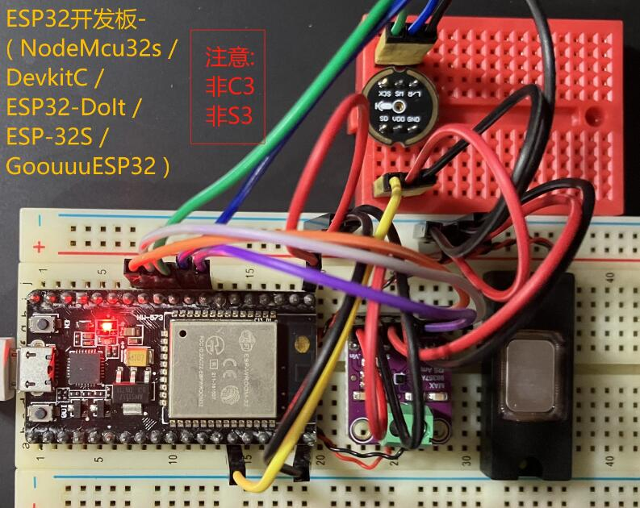<br>v0 面包板原型</td>
<td align="center">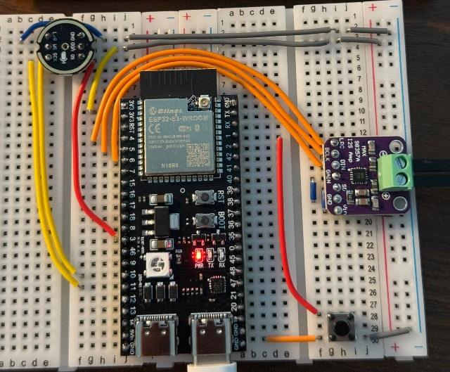<br>接线示意</td>
<td align="center">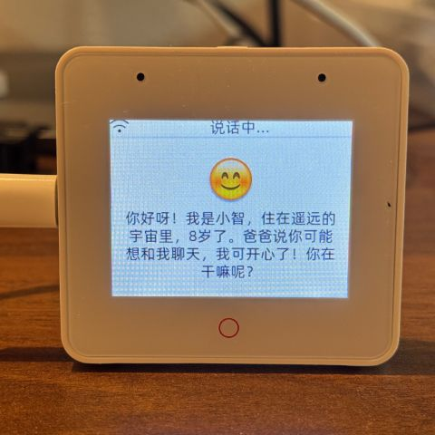<br>v1 乐鑫 BOX3</td>
<td align="center"><br>v1 M5Stack CoreS3</td>
</tr>
</table>

---

## 六、快速开始

### 1. 环境要求

| 项 | 要求 |
| --- | --- |
| 开发环境 | ESP-IDF **v6.1**（最低 v6.0.1，不支持 5.x） |
| Python | **3.10 或更高**（编译与烧录都需要） |
| 工具 | Git、esptool 4.7+ |
| 硬件 | ESP32 开发板、USB 数据线、麦克风、喇叭 |

### 2. 获取源码

```bash
git clone https://github.com/wuzhiguoyy/esp-32.git
cd esp-32
```

### 3. 编译

```bash
idf.py set-target esp32s3
idf.py build
```

### 4. 烧录

```bash
idf.py -p COM3 flash monitor
```

烧不进去时：按住 **BOOT** → 点 **RST** → 松开 BOOT，再烧。

量产合并镜像：

```bash
idf.py merge-bin
# 产物 build/merged-binary.bin，烧录地址 0x0
```

### 5. 开机激活

```text
设备联网 → 服务器生成 6 位激活码 → 网站绑定 → 设备自动激活
```

获取激活码的三种方式：

| 板型 | 方式 |
| --- | --- |
| 带屏 | 屏幕直接显示 |
| 无屏 | 串口查看（115200），日志含 `ACTIVATION CODE: 123456` |
| 带喇叭 | 语音播报（部分板型） |

> 裸板没有屏幕和喇叭也能激活：用串口工具或 `tools/flash.bat` 烧录后自动打开的串口窗口查看激活码。

详细步骤见 [客户快速上手指南](docs/quickstart_zh.md)。

> 未激活设备不能使用语音服务。

### 不想编译？直接烧现成固件

普通客户无需安装 ESP-IDF，下载 bin 用一键脚本烧录即可：

👉 **[客户快速上手指南（5 步）](docs/quickstart_zh.md)** · 烧录工具：[tools/flash.bat](tools/flash.bat)

---

## 七、管理后台

`vue-ai/` 是完整的设备运营后台，Vue 3 + Vite + Element Plus。

**在线体验**：<https://wuzhiguoyy.github.io/esp-32/#/login>

| 演示账号 | 密码 | 权限 |
| --- | --- | --- |
| `demo` | `demo123` | 只读（VIEWER） |

> 演示账号仅用于体验功能，请勿修改数据；正式使用请注册自己的账号。

### 后台界面

<table>
<tr>
<td align="center"><br>登录</td>
<td align="center">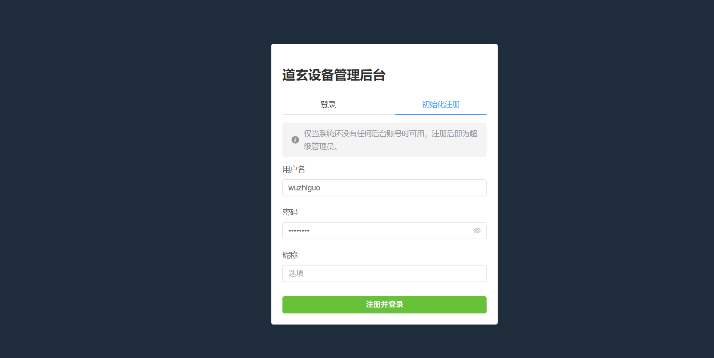<br>初始化注册</td>
<td align="center"><br>概览</td>
</tr>
<tr>
<td align="center">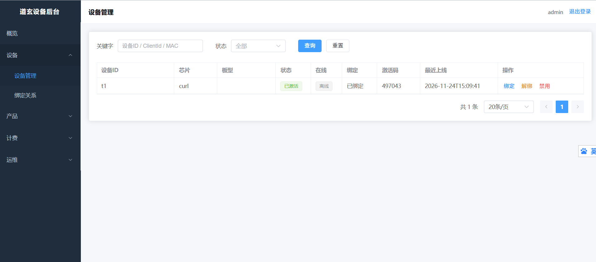<br>设备</td>
<td align="center"><br>设备管理</td>
<td align="center">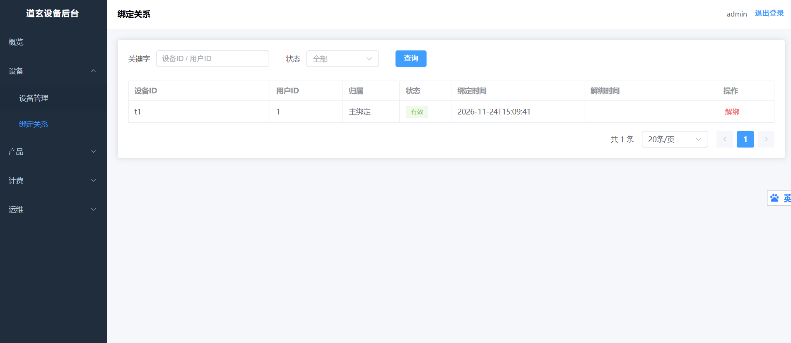<br>绑定关系</td>
</tr>
<tr>
<td align="center">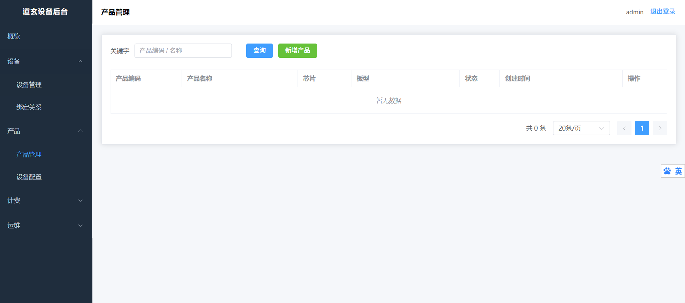<br>产品管理</td>
<td align="center"><br>套餐管理</td>
<td align="center">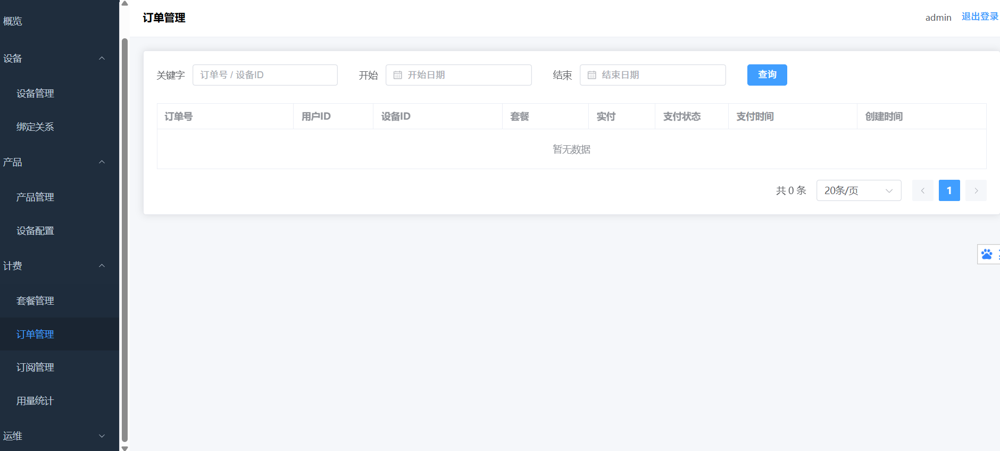<br>订单管理</td>
</tr>
<tr>
<td align="center">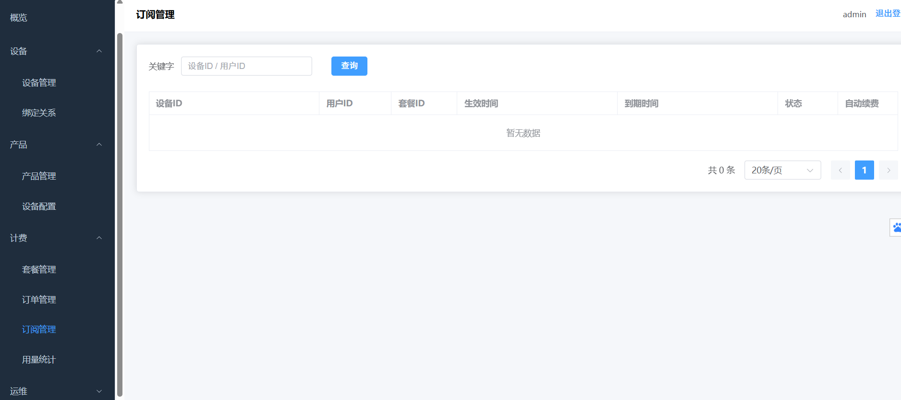<br>订阅管理</td>
<td align="center">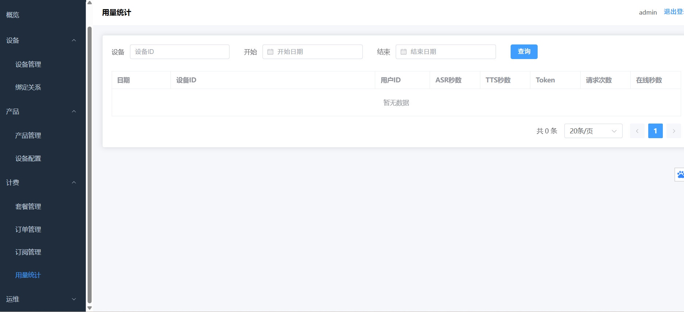<br>用量统计</td>
<td align="center"><br>固件管理</td>
</tr>
<tr>
<td align="center">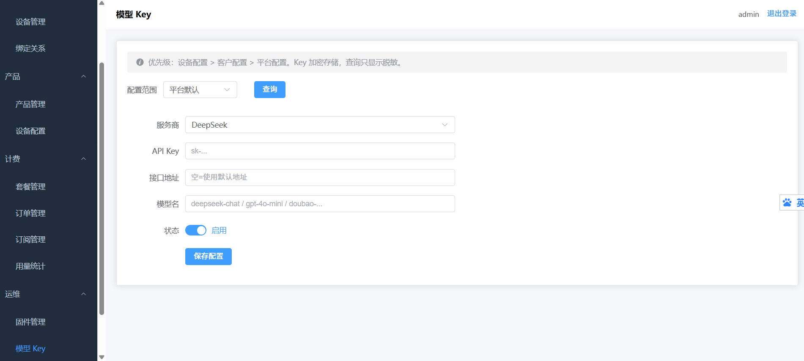<br>模型 Key</td>
<td align="center"></td>
<td align="center"></td>
</tr>
</table>

```bash
cd vue-ai
npm install
npm run dev
```

| 模块 | 功能 |
| --- | --- |
| 概览 | 设备、绑定、套餐、订单数量 |
| 设备管理 | 绑定/解绑、禁用/启用、在线状态 |
| 产品配置 | 板型、运行模式、音色、音量、唤醒词 |
| 计费 | 套餐、订单、订阅、用量 |
| 固件 | 版本、下载地址、发布状态 |
| 模型 Key | 平台 / 客户 / 设备三级配置 |
| 审计 | 后台操作全量留痕 |

支持 GitHub Pages 自动部署，详见 `vue-ai/README.md`。

---

## 八、适用场景

- AI 语音助手 / 智能音箱
- 儿童陪伴机器人 / 故事机
- 桌面机器人 / 潮玩摆件
- 智能家居中控
- 多语种翻译挂件
- 企业定制语音终端

---

## 九、性能与资源

| 指标 | 参考值 |
| --- | --- |
| 唤醒延迟 | < 300 ms（本地唤醒） |
| 对话延迟 | 1.5～3 s（含识别、模型、合成） |
| 音频格式 | Opus 16 kHz 单声道，60 ms 帧 |
| Flash 需求 | ≥ 4 MB（推荐 8 MB / 16 MB） |
| 联网方式 | Wi-Fi 2.4G / 以太网 / 4G |

---

## 十、常见问题

| 现象 | 原因 | 解决 |
| --- | --- | --- |
| 编译报 ESP-IDF 版本错误 | SDK 过低 | 升级到 v6.1 |
| 找不到串口 | 驱动缺失或充电线 | 装 CH340/CP210x，换数据线 |
| 烧录超时 | 未进下载模式 | BOOT + RST |
| 开机没有热点 | 板型选错 | menuconfig 重选 |
| 配网失败 | 5G Wi-Fi | 使用 2.4G |
| 一直显示激活码 | 未绑定 | 后台输入激活码 |
| 有激活无声音 | 喇叭或编解码 | 检查板型与硬件 |

详细排查与日志方法：见 [README_zh.md 历史版本](docs/) 或提交 Issue。

---

## 十一、文档索引

| 文档 | 内容 |
| --- | --- |
| [docs/custom-board_zh.md](docs/custom-board_zh.md) | 自定义开发板 |
| [docs/ota_zh.md](docs/ota_zh.md) | OTA 配置、激活、固件升级 |
| [docs/websocket_zh.md](docs/websocket_zh.md) | WebSocket 语音协议 |
| [docs/mqtt-udp_zh.md](docs/mqtt-udp_zh.md) | MQTT + UDP 协议 |
| [docs/mcp-usage_zh.md](docs/mcp-usage_zh.md) | MCP 设备控制 |
| [docs/features_zh.md](docs/features_zh.md) | 定位、录音、摄像头、防盗扩展 |
| [docs/mcp-protocol_zh.md](docs/mcp-protocol_zh.md) | MCP 交互流程 |
| [vue-ai/README.md](vue-ai/README.md) | 管理后台部署 |

---

## 十二、开源与商业

### 开源范围

- 设备端固件源码（C/C++）
- 管理后台前端（Vue）
- 协议文档与板型配置

### 商业服务

- 官方服务器（OTA、激活、WebSocket）
- 语音识别与语音合成
- 大模型接入与配额
- 设备授权、套餐与技术支持

### 重要说明

固件内置官方服务地址，位于 `main/ota.cc` 的 `GetDefaultOtaUrl()`。

请勿修改该地址：修改后设备将无法激活、对话与升级。

---

## 十三、常见搜索问题

> 以下是用户搜索最多的问题，帮助快速判断这个项目是否适合你。

**Q：ESP32 怎么做 AI 语音助手？**
A：使用本项目固件，`idf.py build` 烧录后连接 Wi-Fi，设备会连接服务端完成语音识别、大模型对话与语音合成。无需自己实现音频链路。

**Q：ESP32-S3 能跑大模型语音对话吗？**
A：可以。S3 负责采集、Opus 编码、播放与设备控制，大模型推理在服务端完成，因此 4MB Flash 的 S3 开发板即可运行。

**Q：ESP32-C3 能做什么语音产品？**
A：适合低成本语音挂件、儿童故事机、翻译挂件。C3 内存较小，建议使用按键说话（PTT）而不是全双工对话。

**Q：ESP32 语音助手需要联网吗？**
A：语音识别、大模型和语音合成需要联网；唤醒词是本地离线识别，断网时仍可唤醒。

**Q：支持哪些语音大模型？**
A：支持 DeepSeek、通义千问、豆包，以及任何 OpenAI 兼容接口，可在后台按平台/客户/设备三级配置 Key。

**Q：可以自己部署服务端吗？**
A：可以。固件侧只需修改 OTA 地址并实现激活、WebSocket 协议；协议文档见 `docs/` 目录。

**Q：支持中文和英文对话吗？**
A：支持。语音识别、合成与界面均支持多语言，可配置为翻译模式实现中英互译。

**Q：一块开发板成本多少？**
A：ESP32-S3 开发板 + 麦克风 + 喇叭，硬件成本约几十元，适合小批量验证与量产。

---

## 十四、贡献指南

- 代码风格：Google C++ Style
- 提交前本地 `idf.py build` 通过
- 新增板型请附 `config.h`、`config.json`、接线说明
- 欢迎提交 Issue 反馈问题与建议

---

## 十五、许可证

本项目基于 **MIT 协议** 的开源 ESP32 语音框架二次开发，原始版权归原作者所有，`LICENSE` 文件必须保留。

品牌、文档与发行由 **上海道玄微数信息科技有限公司** 维护。

## 相关搜索词

> ESP32 语音助手、ESP32 AI 对话、ESP32-S3 大模型、开源语音固件、离线唤醒词、Opus 语音流、MCP 协议、设备激活码、OTA 升级、AI 硬件方案、儿童故事机、陪伴机器人、翻译挂件、无人超市门禁、GPS 定位上报、称重模块、RFID 读卡、微信小程序语音、智能音箱方案、ESP-IDF 教程

---

<div align="center">

**道玄 AI 语音助手** · 让每一块 ESP32 都能开口说话

GitHub：`wuzhiguoyy/esp-32` · Gitee：`wuzhiguo/esp-32`

</div>
