# 道玄 AI 语音助手（ESP32 固件）

> 面向客户与渠道的完整说明：怎么烧、怎么用、怎么接入官方服务。

- 英文版：[README.md](README.md)
- 许可证：[MIT](LICENSE)

---

## 一、这是什么

这是运行在 **ESP32 系列芯片**上的 AI 语音助手固件。

设备开机后：

1. 连接 Wi-Fi（或 4G / 网线）；
2. 自动连接**道玄官方服务**；
3. 语音唤醒后即可对话：说话 → 识别 → 大模型回答 → 语音播报。

固件**已内置官方服务地址**，刷完即用，不需要自己搭服务器、不需要填任何地址。

支持芯片：ESP32、ESP32-C3、ESP32-C5、ESP32-C6、ESP32-S3、ESP32-P4。

---

## 二、你需要准备

### 硬件

| 项目 | 要求 |
| --- | --- |
| 开发板 | ESP32-S3 推荐（4MB 以上 Flash，带麦克风和喇叭） |
| 数据线 | 支持数据传输的 USB 线（不是纯充电线） |
| 电脑 | Windows 10/11、macOS 或 Linux |

> 第一次建议用 **ESP32-S3 + 4MB Flash** 的板子，成功率最高。

### 软件

- **ESP-IDF v6.1**（必须 6.0.1 以上，不支持 5.x）
- Git
- Python 3.10+
- USB 串口驱动（CH340 / CP210x，按板子来）

---

## 三、安装 ESP-IDF

### Windows（推荐）

1. 下载乐鑫官方安装器：ESP-IDF Tools Installer（选 **v6.1**）；
2. 一路下一步，安装路径不要有中文和空格；
3. 安装完成后桌面会有 **ESP-IDF PowerShell** 快捷方式；
4. 打开它，输入：

```bash
idf.py --version
```

能看到 `ESP-IDF v6.1` 即成功。

### macOS / Linux

```bash
git clone -b release/v6.1 --recursive https://github.com/espressif/esp-idf.git
cd esp-idf
./install.sh
. ./export.sh
```

> 必须用 `release/v6.1` 分支，不要用 `v6.1` 标签。

---

## 四、获取源码

```bash
git clone https://github.com/wuzhiguoyy/esp-32.git
cd esp-32
```

国内网络慢可以用镜像或代理。

---

## 五、选择板型

```bash
idf.py menuconfig
```

菜单路径：

```
Xiaozhi Assistant → Board Type
```

选择你手上的板子。常见板型：

| 板型 | 说明 |
| --- | --- |
| `bread-compact-wifi` | ESP32-S3 面包板 + 麦克风 + 喇叭，最通用 |
| `esp32-s3-box-3` | 乐鑫 ESP32-S3-BOX-3 |
| `m5stack-core-s3` | M5Stack CoreS3 |
| `xmini-c3` | 迷你 C3 板 |
| `waveshare-esp32-s3-touch-amoled-1.8` | 微雪 AMOLED 板 |

完整列表在 `main/boards/` 目录。

**列表里没有你的板子？**

参考 [自定义开发板指南](docs/custom-board_zh.md)，复制一个相近的板型改引脚即可。

### 5.1 两种硬件形态：v0 与 v1

仓库里的 `docs/v0/` 和 `docs/v1/` 是两套硬件参考图：

| 目录 | 含义 | 适合谁 |
| --- | --- | --- |
| `docs/v0/` | **原型验证**：面包板 + 杜邦线 + 开发板 + 麦克风 + 喇叭 | 个人开发者、第一次验证方案 |
| `docs/v1/` | **成品形态**：带外壳或成品的开发板，接线规整 | 产品选型、批量生产 |

#### v0：面包板原型

适合先花几十块钱验证“能不能跑通”。

<table>
<tr>
<td align="center"><br>ESP32 面包板</td>
<td align="center"><br>接线示意</td>
<td align="center">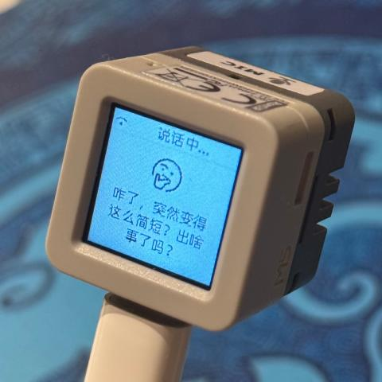<br>AtomS3R + Echo Base</td>
<td align="center">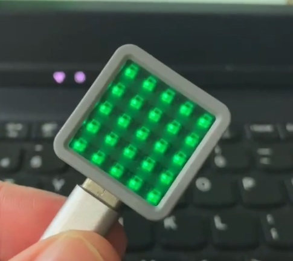<br>AtomMatrix + Echo Base</td>
</tr>
<tr>
<td align="center">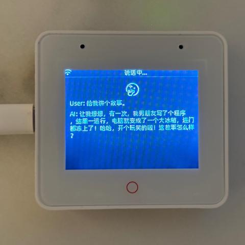<br>ESP32-S3-BOX3</td>
<td align="center">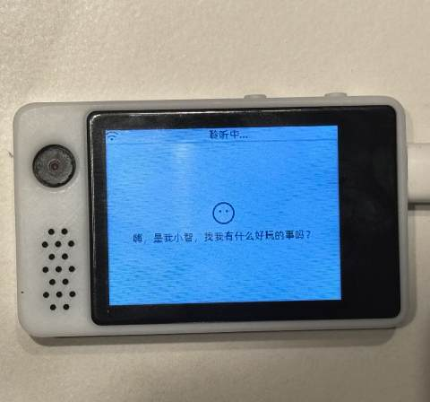<br>立创·实战派 S3</td>
<td align="center">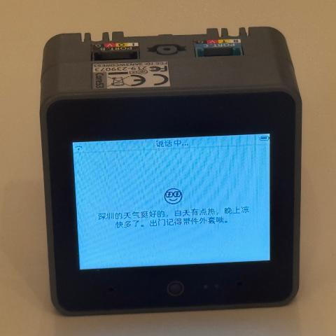<br>M5Stack CoreS3</td>
<td align="center">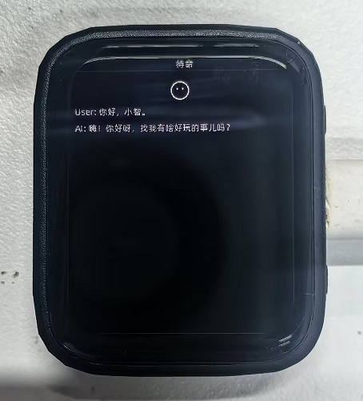<br>微雪 AMOLED 1.8</td>
</tr>
</table>

#### v1：成品与开发板

适合直接选型、做产品。

<table>
<tr>
<td align="center"><br>乐鑫 ESP32-S3-BOX3</td>
<td align="center">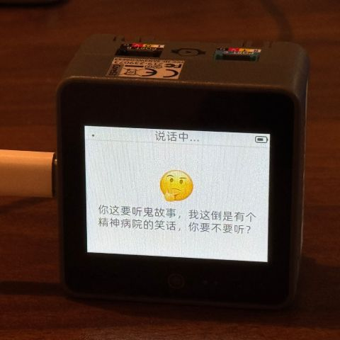<br>M5Stack CoreS3</td>
<td align="center">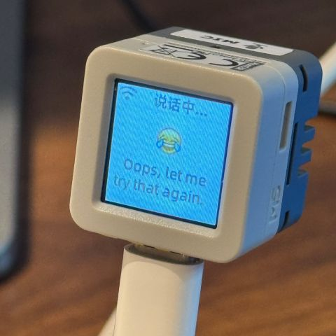<br>AtomS3R</td>
<td align="center">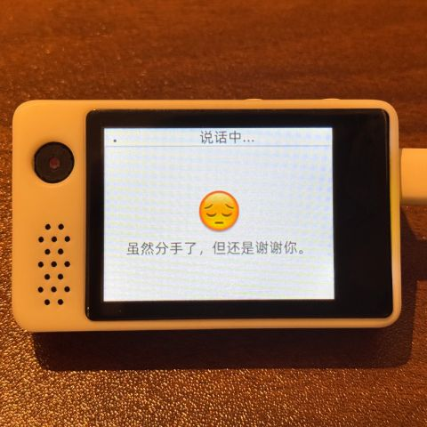<br>立创·实战派 S3</td>
</tr>
<tr>
<td align="center">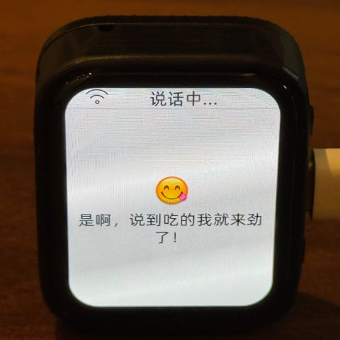<br>微雪 AMOLED</td>
<td align="center">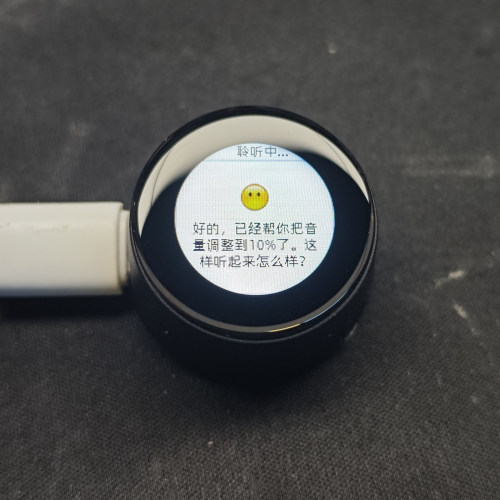<br>LILYGO T-Circle-S3</td>
<td align="center">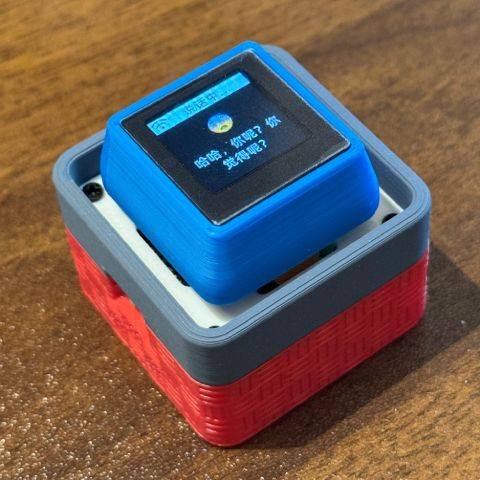<br>神奇按钮 2.4</td>
<td align="center">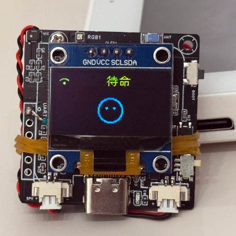<br>Mini C3</td>
</tr>
<tr>
<td align="center">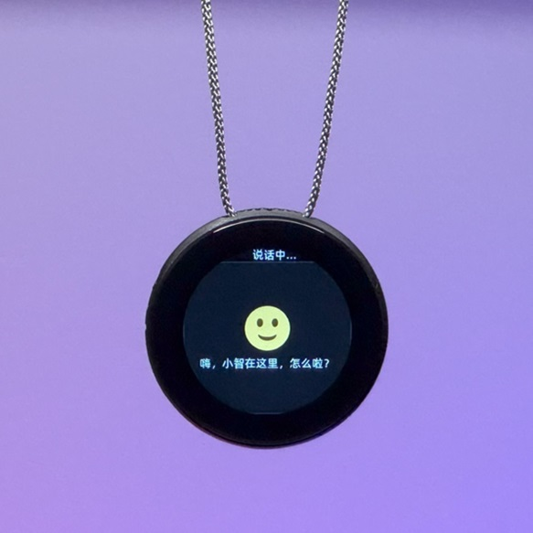<br>璀璨 AI 吊坠</td>
<td align="center">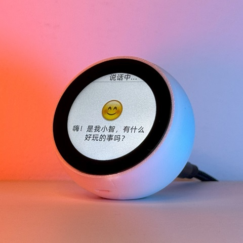<br>Moji 吊坠</td>
<td align="center">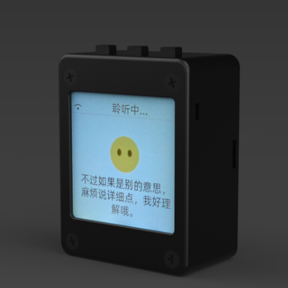<br>星智 1.54TFT</td>
<td align="center"><br>SenseCAP Watcher</td>
</tr>
<tr>
<td align="center">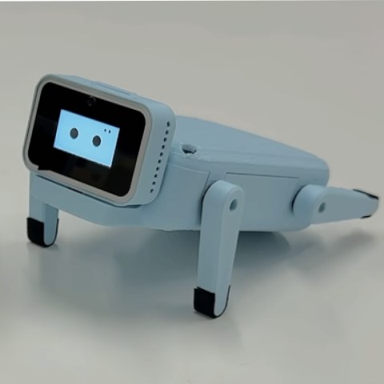<br>ESP-HI 机器狗</td>
<td align="center">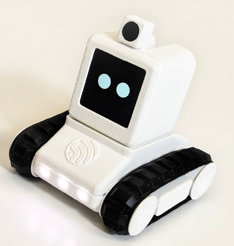<br>ESP-SparkBot</td>
<td align="center">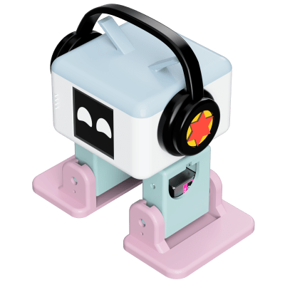<br>Otto 机器人</td>
<td align="center">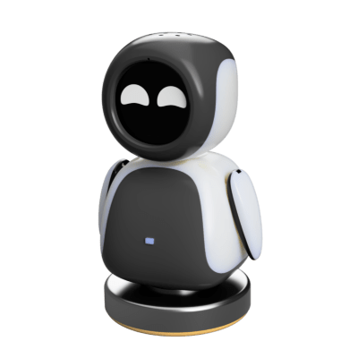<br>Electron Bot</td>
</tr>
<tr>
<td align="center">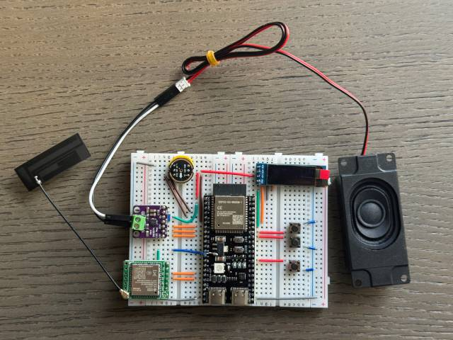<br>成品接线</td>
<td align="center">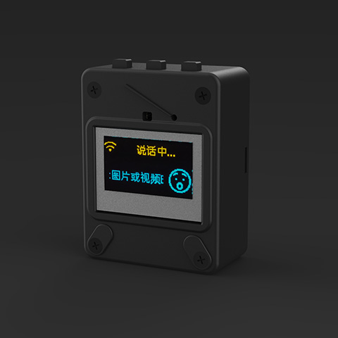<br>星智 0.96 OLED</td>
<td align="center"></td>
<td align="center"></td>
</tr>
</table>

> 图片只用于说明形态差异，具体引脚以 `main/boards/` 下对应板型的 `config.h` 为准。

---

## 六、设置芯片型号

```bash
idf.py set-target esp32s3
```

对应关系：

| 芯片 | 命令 |
| --- | --- |
| ESP32 | `idf.py set-target esp32` |
| ESP32-C3 | `idf.py set-target esp32c3` |
| ESP32-C6 | `idf.py set-target esp32c6` |
| ESP32-S3 | `idf.py set-target esp32s3` |
| ESP32-P4 | `idf.py set-target esp32p4` |

> `set-target` 会清空 `build/`，切换芯片后必须重新编译。

---

## 七、编译

```bash
idf.py build
```

成功后会看到：

```
Project build complete. To flash, run:
 idf.py flash
```

产物在 `build/` 目录，主要文件：

| 文件 | 用途 |
| --- | --- |
| `build/xiaozhi.bin` | 应用固件 |
| `build/bootloader/bootloader.bin` | 引导 |
| `build/partition_table/partition-table.bin` | 分区表 |
| `build/merged-binary.bin` | 合并镜像（量产用） |

---

## 八、烧录

### 1. 连接设备

用 USB 线连接电脑，查看串口号：

- Windows：设备管理器 → 端口（COM 和 LPT），例如 `COM3`；
- macOS：`ls /dev/cu.*`；
- Linux：`ls /dev/ttyUSB*`。

### 2. 一键烧录

```bash
idf.py -p COM3 flash monitor
```

- `COM3` 换成你的串口；
- `monitor` 会打开串口日志，按 `Ctrl+]` 退出。

### 3. 烧不进去怎么办

多数是没进入下载模式：

1. 按住 **BOOT** 键不放；
2. 按一下 **RST** 键；
3. 松开 BOOT；
4. 重新执行烧录命令。

部分板子（如 ESP32-S3-BOX）支持自动下载，不需要手动按键。

如果波特率太高导致失败：

```bash
idf.py -p COM3 -b 115200 flash monitor
```

### 4. 量产烧录（推荐）

生成合并镜像：

```bash
idf.py merge-bin
```

得到 `build/merged-binary.bin`，用乐鑫 **Flash Download Tool**：

| 地址 | 文件 |
| --- | --- |
| `0x0` | `merged-binary.bin` |

选择芯片型号 → 选串口 → START，即可批量烧录。

### 5. 只更新应用（不重刷引导）

```bash
idf.py -p COM3 app-flash monitor
```

---

## 九、第一次开机

### 1. 配网

设备首次开机会进入配网模式：

- 手机搜索 Wi-Fi，连接名为 `Daoxuan-xxxx` 的热点；
- 浏览器打开 `192.168.4.1`；
- 选择你家/公司的 Wi-Fi，输入密码；
- 保存后设备自动重启并联网。

也支持：

- **BluFi** 蓝牙配网（部分板子）；
- **有线以太网**；
- **4G 模块**（ML307 / NT26 等）。

### 2. 激活

联网后设备会显示/播报一个 **6 位激活码**。

把激活码交给官方（用户中心或客服），绑定到你的账号后：

- 设备自动完成激活；
- 屏幕提示激活成功；
- 即可正常对话。

> 未激活的设备不能使用语音服务。

### 3. 使用

| 操作 | 说明 |
| --- | --- |
| 唤醒 | 说“你好小智”（默认唤醒词） |
| 说话 | 唤醒后直接说话，停顿后自动发送 |
| 打断 | 播放时再次唤醒或按键 |
| 音量 | 语音指令“音量调到 50”或按键 |

---

## 十、不要修改服务地址（重要）

固件内置**官方服务地址**，位置在：

```
main/ota.cc → GetDefaultOtaUrl()
```

该地址负责：

- 设备激活
- 语音识别（ASR）
- 大模型对话（LLM）
- 语音合成（TTS）
- 固件升级（OTA）

### 为什么不建议改

| 行为 | 结果 |
| --- | --- |
| 改成自己的服务器 | 需要自己实现 OTA、激活、ASR、LLM、TTS 全链路 |
| 改成不存在的地址 | 设备无法激活、无法对话、无法升级 |
| 删除这段代码 | 固件没有默认地址，首次开机无法连接服务 |

### 官方服务说明

- 官方服务是**付费服务**，按设备数量/年限收费；
- 开源的是**设备端固件代码**；
- 服务器、语音识别、大模型、语音合成不在开源范围内；
- 具体套餐与价格请联系商务。

---

## 十一、常见问题

| 现象 | 原因 | 解决办法 |
| --- | --- | --- |
| 编译报 `ESP-IDF version` 错误 | SDK 版本太低 | 升级到 v6.1 |
| 找不到串口 | 驱动没装/线是充电线 | 装 CH340/CP210x 驱动，换数据线 |
| 烧录超时 | 没进下载模式 | 按住 BOOT 再按 RST |
| 开机没有热点 | 板型选错 | menuconfig 重新选板型 |
| 配网后连不上 | Wi-Fi 是 5G 或需要网页认证 | 用 2.4G Wi-Fi |
| 一直显示激活码 | 未绑定 | 联系客服绑定激活码 |
| 能激活但没声音 | 喇叭或编解码配置错 | 检查板型与硬件 |
| 对话没反应 | 设备离线/服务异常 | 查看串口日志，联系客服 |
| 日志乱码 | 波特率不对 | monitor 波特率改为 115200 |

查看日志：

```bash
idf.py -p COM3 monitor
```

---

## 十二、目录结构

```
main/                 固件源码
├── boards/           板型定义（138 个目录）
├── audio/            音频、唤醒词
├── display/          屏幕与表情
├── protocols/        WebSocket / MQTT 协议
├── mcp_server.cc     设备控制（MCP）
└── ota.cc            OTA 与激活
partitions/           分区表
docs/                 开发文档
scripts/              构建与资源工具
sdkconfig.defaults*   各芯片默认配置
```

---

## 十三、二次开发

| 需求 | 参考文档 |
| --- | --- |
| 新增板子 | [自定义开发板指南](docs/custom-board_zh.md) |
| 改 OTA/激活协议 | [OTA 文档](docs/ota_zh.md) |
| 改语音协议 | [WebSocket 协议](docs/websocket_zh.md) |
| 设备控制 | [MCP 用法](docs/mcp-usage_zh.md) |
| 改唤醒词/表情/字体 | `main/assets/` 与 `scripts/` |

> 自定义唤醒词需要 ESP-SR 模型训练，参考乐鑫相关文档。

---

## 十四、管理后台（vue-ai）

仓库里的 `vue-ai/` 是设备管理后台前端，Vue 3 + Vite + Element Plus。

### 14.1 能做什么

| 页面 | 功能 |
| --- | --- |
| 概览 | 设备、绑定、套餐、订单数量 |
| 设备管理 | 分页筛选、绑定/解绑用户、禁用/启用 |
| 绑定关系 | 查看归属、解绑 |
| 产品管理 | 新增/编辑产品与板型 |
| 设备配置 | 音色、模式（chat/translate）、音量、唤醒词 |
| 套餐 | 新增/编辑，按月/年/次/永久 |
| 订单 / 订阅 / 用量 | 查询、按日期筛选 |
| 固件 | 版本、下载地址、发布状态 |
| 后台账号 | 新增、编辑、重置密码 |
| 操作审计 | 后台所有写操作留痕 |

### 14.2 本地运行

```bash
cd vue-ai
npm install
npm run dev
```

打开 `http://localhost:5173`，粘贴后台 JWT Token 登录。

开发代理默认 `http://127.0.0.1:8282`，换地址用 `.env.local`：

```
VITE_PROXY_TARGET=https://你的服务端地址
```

### 14.3 构建

```bash
cd vue-ai
npm run build
```

产物在 `vue-ai/dist/`，可直接部署到任意静态服务器。

### 14.4 部署到 GitHub Pages

仓库已内置工作流 `.github/workflows/pages.yml`，推送后自动构建发布。

**第一步：开启 Pages**

```
仓库 Settings → Pages → Source 选择 GitHub Actions
```

**第二步：配置接口地址**

```
Settings → Secrets and variables → Actions → New repository secret
Name:  VITE_API_BASE
Value: 你的服务端地址（含 https://）
```

接口地址只存在 Secret 中，**不会出现在公开代码里**。

**第三步：推送触发**

```bash
git add vue-ai .github
git commit -m "feat: 管理后台"
git push
```

发布地址：

```
https://<用户名>.github.io/<仓库名>/
```

例如本仓库为 `https://wuzhiguoyy.github.io/esp-32/`。

### 14.5 环境变量

| 变量 | 作用 | 默认 |
| --- | --- | --- |
| `VITE_API_BASE` | 接口根地址 | 空（同域 `/api`） |
| `VITE_BASE` | 静态资源前缀 | `/`（Pages 下为 `/仓库名/`） |
| `VITE_PROXY_TARGET` | 开发代理目标 | `http://127.0.0.1:8282` |

### 14.6 登录与接口

- 后台接口统一 `/api/admin/esp32/**`；
- 需要 JWT，未登录返回 401；
- 前端把 Token 存在浏览器 `localStorage`；
- 后端已开启跨域，Pages 域名可直接调用；
- 路由使用 hash 模式，刷新不会 404。

### 14.7 安全提示

- Pages 页面是公开的，但**没有 Token 调不了接口**；
- 生产环境建议绑定自有域名并加 HTTPS；
- 不要把 `esp32_admin_user` 的管理员密码写进前端；
- 后续可把后台前端迁到私有仓库，只开放演示账号。

---

## 十五、许可证与声明

- 本项目基于 **MIT 协议**的开源 ESP32 语音框架二次开发；
- 原始版权归原作者所有，`LICENSE` 文件必须保留；
- 品牌、文档、发行由**上海道玄微数信息科技有限公司**维护；
- 开源范围：设备端固件源码；
- 商业服务范围：官方服务器、语音识别、大模型、语音合成、设备管理与升级。

---

## 十六、联系我们

- 公司：上海道玄微数信息科技有限公司
- 商务合作：联系售后或销售获取账号与套餐
- 技术支持：提交 Issue 或联系对接人
